<h1 align="center">
  <picture>
    <source media="(prefers-color-scheme: dark)" srcset="assets/readme/hero-dark.svg">
    <source media="(prefers-color-scheme: light)" srcset="assets/readme/hero-light.svg">
    
  </picture>
</h1>

<p align="center"><sub>One agent run, set as a score. The agent opens a turn, the model streams its reply, two tools start<br>together and finish apart, and a second turn closes the run. The labels are events <code>maestro-agent</code> emits.</sub></p>

<p align="center">
  <a href="https://github.com/Orchestration-Maestro/maestro/actions?query=branch%3Amain"><picture><source media="(prefers-color-scheme: dark)" srcset="assets/readme/badges/checks-dark.svg"></picture></a>
  <a href="rust-toolchain.toml"><picture><source media="(prefers-color-scheme: dark)" srcset="assets/readme/badges/rust-dark.svg"></picture></a>
  <a href=".github/ci.toml"><picture><source media="(prefers-color-scheme: dark)" srcset="assets/readme/badges/platforms-dark.svg"></picture></a>
  <a href="LICENSE"><picture><source media="(prefers-color-scheme: dark)" srcset="assets/readme/badges/license-dark.svg"></picture></a>
  <a href="docs"><picture><source media="(prefers-color-scheme: dark)" srcset="assets/readme/badges/docs-dark.svg"></picture></a>
</p>

Maestro is an agent engine written in Rust. You hand it a prompt; it streams the
model's reply, runs the tools the model calls and carries on until the model has
nothing left to ask for. Every step comes out as an ordered event you can observe,
and every part of the engine is a crate with one job.

## The parts

- [`maestro-agent`](docs/loop.md) runs the turns. It streams the reply, runs tool
  calls (in parallel by default) and queues steering and follow-up messages.
- [`maestro-models`](docs/models/catalog.md) speaks nine wire protocols and carries
  an offline catalog of 970 models from 31 providers.
- [`maestro-tools`](docs/tools.md) provides read, write, edit, bash, grep, find and
  ls.
- [`maestro-session`](docs/sessions/session_manager.md) keeps history as an
  append-only JSONL tree that you can continue, fork, branch and compact.
- [`maestro-tui`](docs/terminal/rendering.md) draws the terminal. It rewrites only
  the rows that changed, keeps your scrollback and ships an editor with completion.

The [crate graph](docs/specs/maestro-port.md#crates-and-delivery-order) lists the
rest. Dependencies point one way, down towards small leaf crates, and a
[conventions test](crates/maestro-test-conventions) reads `cargo metadata` to fail
any edge the graph does not allow.

## In the terminal

<p align="center">
  <picture>
    <source media="(prefers-color-scheme: dark)" srcset="assets/readme/chat-demo-dark.svg">
    
  </picture>
</p>

<p align="center"><sub>The terminal toolkit's <a href="docs/terminal/examples.md">chat example</a>, recorded on Linux from <code>main</code>.<br>Replies are simulated locally, so the demo needs no account and makes no network calls.</sub></p>

## Quick start

On Linux, with Git and [rustup](https://rustup.rs):

```sh
git clone https://github.com/Orchestration-Maestro/maestro.git
cd maestro
rustup toolchain install    # the Rust version pinned in rust-toolchain.toml
cargo run --locked -p maestro-tui-crossterm --example chat_simple
```

Type `/` for commands, press Tab to complete a path and Ctrl+C to quit. To work on
Maestro itself, install [mise](https://mise.jdx.dev) and run `mise install`, then
`mise exec -- just setup`; [development](docs/development.md) has the details.

## The rules

They live in the build files. `just check` fails on any of them, and the commit
hook runs it before every commit:

```toml
# Cargo.toml
[workspace.lints.rust]
unsafe_code = "forbid"

[workspace.lints.clippy]
pedantic = { level = "forbid", priority = -1 }
missing_docs_in_private_items = "forbid"
unwrap_used = "forbid"
expect_used = "forbid"
panic = "forbid"
```

`clippy.toml` adds the limits: five parameters, 60 lines and a cognitive
complexity of 15 per function. Shared CI runs formatting, Clippy, documentation,
the tests on Linux, a WebAssembly build and compile checks for macOS and Windows
on every pull request.

## Status

Maestro has no release and no `maestro` command yet. What exists today is a set of
tested libraries and the examples above.

- On `main`: models and providers, the agent loop, tools, sessions, settings,
  credentials, packages and the terminal toolkit.
- In progress: the application layer, the terminal chat and browser front ends, and
  the Markdown parser.
- Not on `main` yet: the `maestro` command, the RPC and command-line front ends,
  the extension runtime and the workspace daemon.

## Documentation

[Agent loop](docs/loop.md) · [tools](docs/tools.md) · [sessions](docs/sessions/session_manager.md) ·
[model catalog](docs/models/catalog.md) · [terminal toolkit](docs/terminal/components.md) ·
[architecture checks](docs/architecture.md) · [foundation specification](docs/specs/maestro-port.md) ·
[identity](docs/identity.md)

## Contributing

Start with [CONTRIBUTING.md](CONTRIBUTING.md). [AGENTS.md](AGENTS.md) records the
code, documentation and Git rules each change follows.

## Licence

[MIT](LICENSE).
