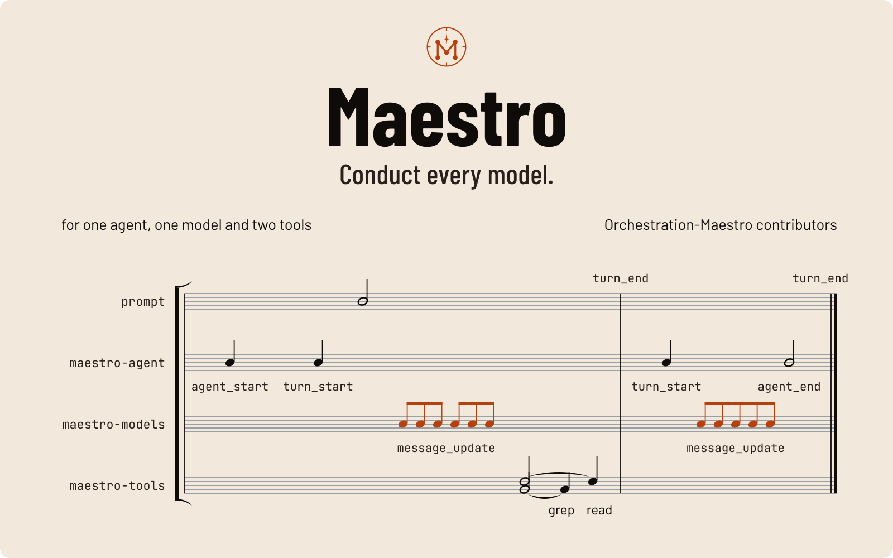
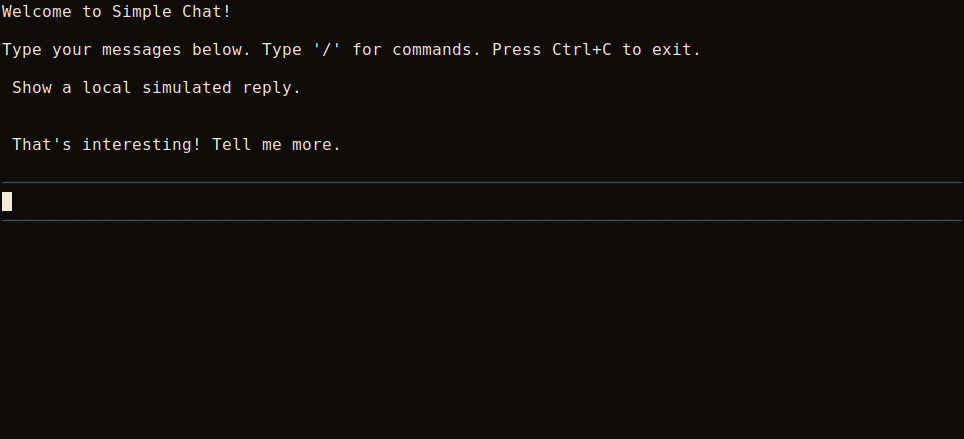
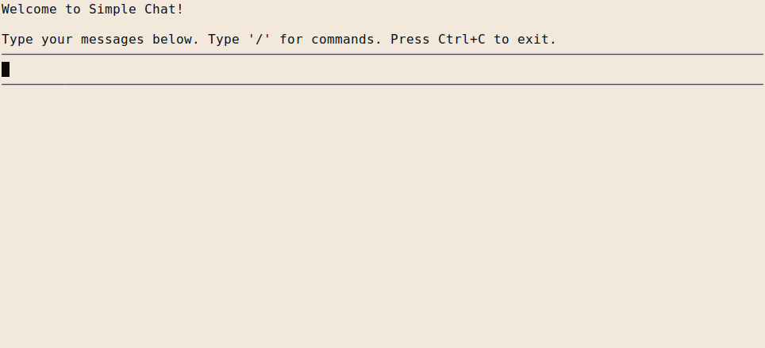
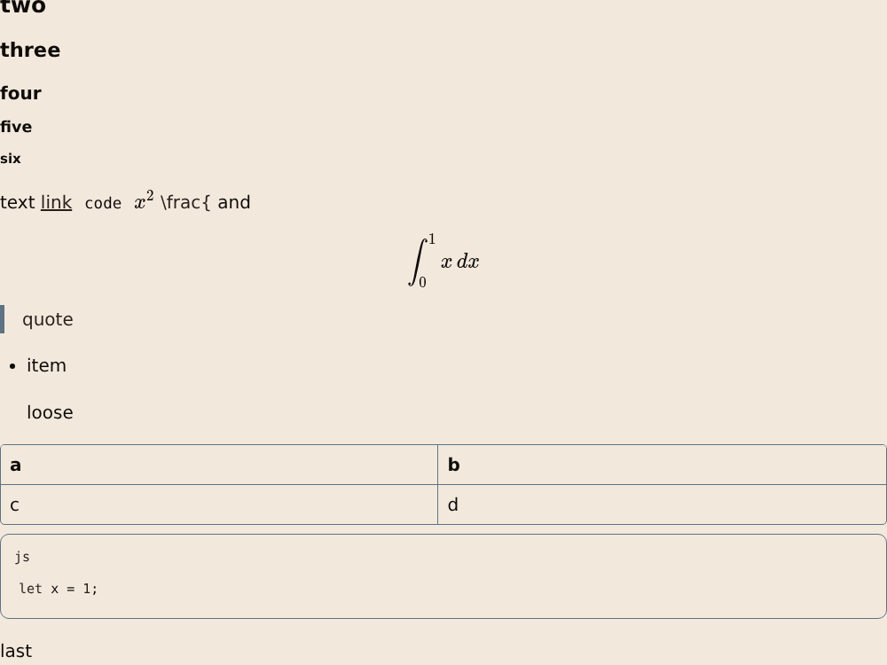
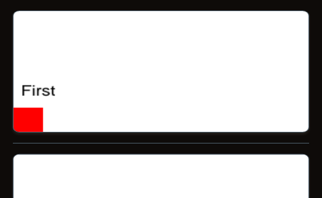

<picture>
  <source media="(prefers-color-scheme: dark)" srcset="assets/readme/hero-dark.svg">
  <source media="(prefers-color-scheme: light)" srcset="assets/readme/hero-light.svg">
  
</picture>

# Maestro

**Conduct every model.**

A Rust engine for model conversations, tools and retained sessions.
[Explore the engine](docs/agent.md) or [run the local chat demo](#quick-start).

[](https://github.com/Orchestration-Maestro/maestro/actions)
[](LICENSE)
[](rust-toolchain.toml)
[](.github/ci.toml)
[](#documentation)

**In development:** these are [engine libraries and interface components](docs/architecture.md),
not a finished assistant application. The demo below runs locally with simulated replies;
it needs no provider account.

## Why Maestro

Running a model conversation means executing tools, retaining usable history
and controlling the next turn. Maestro puts that work in a
[Rust agent engine](docs/agent.md), with
[replaceable adapters and explicit crate boundaries](docs/specs/maestro-port.md#crates-and-delivery-order).
Use the parts without putting application policy inside a provider or a frontend.

## What you get

| | Capability | What it gives you |
| --- | --- | --- |
|  | **Model choice** | [Discover and register models](docs/catalog.md) separately from the code that calls them. |
|  | **Tools in the loop** | [Read, edit, write and run shell commands](docs/tools.md) through tool records the engine can consume. |
|  | **Retained sessions** | [Persist, branch and revisit conversation history](docs/sessions/session_manager.md) across runs. |

## See it

These are real [local examples](docs/terminal/examples.md) and
[browser components](crates/maestro-web), not screenshots of an integrated app.

### Local chat demo · simulated replies



The [chat example](crates/maestro-tui-crossterm/examples/chat_simple.rs) handles
input and renders local simulated replies. It does not call a model.



Light terminal profile, startup state. The example's explicit accent styles
remain dark; this is not an application theme selector.

### Browser components · Markdown, code and math

<picture>
  <source media="(prefers-color-scheme: dark)" srcset="assets/readme/screens/browser-components-dark.png">
  <source media="(prefers-color-scheme: light)" srcset="assets/readme/screens/browser-components-light.png">
  
</picture>

The [Markdown component](crates/maestro-web/src/components/markdown_block)
rendered with the shipped dark and light brand profiles.

### Document artifact component



A real [document artifact](crates/maestro-web/src/tools/artifacts) in the browser
component harness. The document supplies its own page content.

## Quick start

On Unix, install [Git](https://git-scm.com/downloads),
[mise](https://mise.jdx.dev/getting-started.html) and
[rustup](https://rustup.rs/). Then run:

```sh
git clone https://github.com/Orchestration-Maestro/maestro.git
cd maestro
mise install
mise exec -- just setup
mise exec -- cargo run --locked -p maestro-tui-crossterm --example chat_simple
```

Type a message; press **Enter** for a simulated reply. **Ctrl+C** exits.
This launches the [local chat example](docs/terminal/examples.md), not an
installed assistant. Build and test instructions live in the
[development guide](docs/development.md).

## How it is built

[The agent loop](docs/agent.md), [model catalog](docs/catalog.md),
[tools](docs/tools.md) and [session history](docs/sessions/session_manager.md)
have separate owners. [The architecture](docs/architecture.md) enforces dependency
direction so frontends call the application layer rather than one another.

The [contributor checks](AGENTS.md#checks) include formatting, Clippy,
strict documentation and workspace conventions. Shared CI runs tests on Linux
and checks compilation for the [declared cross-platform targets](.github/ci.toml);
that is not a claim of runtime testing on macOS or Windows.

## Status

Delivered libraries and components are documented in the guides below.
Application composition and author builds are still in progress; there is no
published integrated launcher in this quick start.

**Coming:** [chat composition](https://github.com/Orchestration-Maestro/maestro/issues/822),
[embedding example](https://github.com/Orchestration-Maestro/maestro/issues/823),
[author builds](https://github.com/Orchestration-Maestro/maestro/issues/113).

## Documentation

- [Agent execution](docs/agent.md) · [Model catalog](docs/catalog.md) · [Tools](docs/tools.md)
- [Sessions](docs/sessions/session_manager.md) · [Terminal examples](docs/terminal/examples.md)
- [Architecture](docs/architecture.md) · [Foundation contract](docs/specs/maestro-port.md)
- [Identity](docs/identity.md) · [Brand projection](docs/brand.md)
- [Development](docs/development.md) · [Issue workflow](docs/agents/issue-tracker.md)

## Contributing

Read [CONTRIBUTING.md](CONTRIBUTING.md) before opening an issue or pull request.
[AGENTS.md](AGENTS.md) records the repository's code, documentation and Git rules.
Keep changes focused on an existing issue and its owning capability.

## Licence

[MIT](LICENSE).
