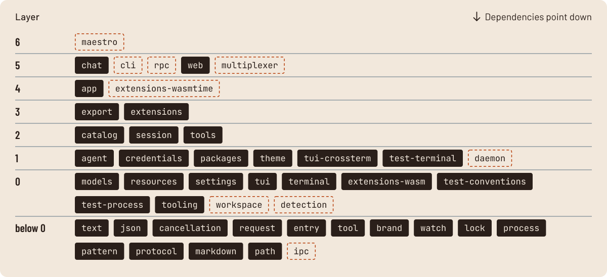

<h1 align="center">
  <picture>
    <source media="(prefers-color-scheme: dark)" srcset="assets/readme/hero-dark.svg">
    <source media="(prefers-color-scheme: light)" srcset="assets/readme/hero-light.svg">
    
  </picture>
</h1>

<p align="center">
  <a href="https://github.com/Orchestration-Maestro/maestro/actions?query=branch%3Amain"></a>
  <a href="rust-toolchain.toml"></a>
  <a href=".github/ci.toml"></a>
  <a href="LICENSE"></a>
  <a href="docs"></a>
</p>

Maestro is an agent engine in Rust. It talks to 970 models through one interface,
runs the tools they call, and keeps each session as a tree in a plain file. It is
being built in the open, one crate at a time, and this is how far it has come.

## The terminal, today

<p align="center">
  
</p>

<p align="center"><sub>The toolkit's <a href="docs/terminal/examples.md">chat example</a>, recorded on Linux from <code>main</code>. Replies are simulated locally, so it runs without an account.</sub></p>

## Why Maestro

### Every model, one interface

In Maestro a provider is data in a compiled-in [catalog](docs/models/catalog.md)
(970 models from 31 providers today), and each wire protocol is one adapter. All
nine adapters sit behind the same request call, so moving to another model means
passing another descriptor, not writing new code.

### Rules that run

`unsafe`, `unwrap`, `expect` and `panic!` are forbidden in production code, every
item carries documentation, functions stop at 60 lines and five parameters, and
files at 500 lines. Clippy and a [conventions test](docs/architecture.md#quality-checks)
check all of it on every commit and every pull request.

### History you keep

A [session](docs/sessions/session_manager.md) is a JSONL file on your disk. Every
entry points to its parent, so one file holds every branch you tried. Continue it,
fork it or compact it; nothing is thrown away.

## Built in layers

<p align="center">
  <picture>
    <source media="(prefers-color-scheme: dark)" srcset="assets/readme/crates-dark.svg">
    
  </picture>
</p>

<p align="center"><sub>Every crate from the <a href="docs/specs/maestro-port.md#crates-and-delivery-order">crate graph</a>, without the <code>maestro-</code> prefix.<br>Solid: on <code>main</code> today. Outlined: specified, not built yet.</sub></p>

Each crate has one job, and dependencies only point down. Front ends call one
application crate and never each other. The conventions test reads `cargo metadata`
and fails on any edge the graph does not allow.

## Quick start

On Linux, with Git and [rustup](https://rustup.rs):

```sh
git clone https://github.com/Orchestration-Maestro/maestro.git
cd maestro
rustup toolchain install    # the Rust version pinned in rust-toolchain.toml
cargo run --locked -p maestro-tui-crossterm --example chat_simple
```

Type `/` for commands, press Tab to complete a path and Ctrl+C to quit.
[Development](docs/development.md) explains the full setup with mise and the
commit hooks.

## Status

There is no release and no `maestro` command yet; the layers above show what is
built. The libraries on `main` have tests that run on Linux in CI, and CI also
compiles the workspace for macOS and Windows.

## Documentation

- [Agent loop](docs/loop.md), [tools](docs/tools.md), [sessions](docs/sessions/session_manager.md)
- [Model catalog](docs/models/catalog.md), [terminal toolkit](docs/terminal/components.md)
- [Architecture checks](docs/architecture.md), [foundation specification](docs/specs/maestro-port.md)
- [Identity and brand](docs/identity.md)

## Contributing

Read [CONTRIBUTING.md](CONTRIBUTING.md) first. [AGENTS.md](AGENTS.md) lists the
rules every change follows.

## Licence

[MIT](LICENSE).
